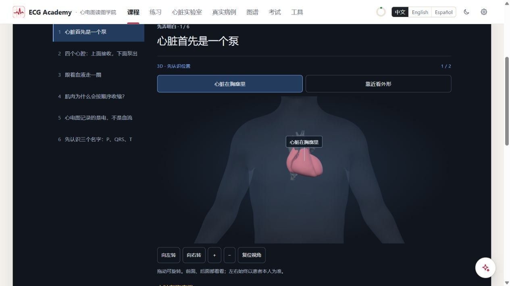
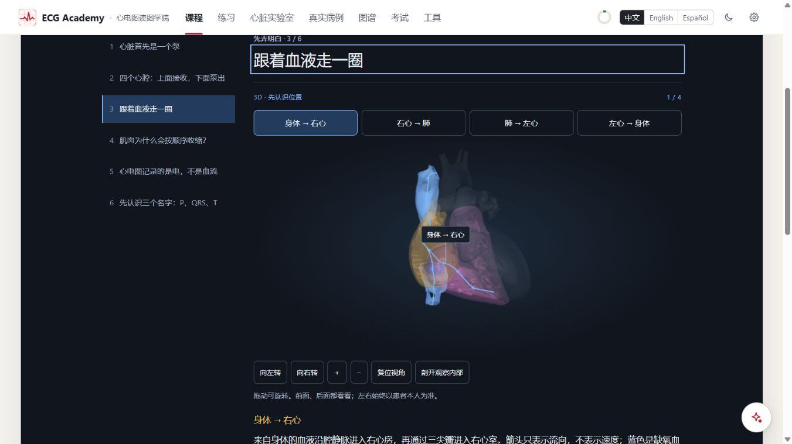
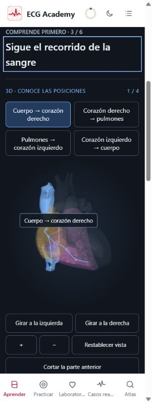
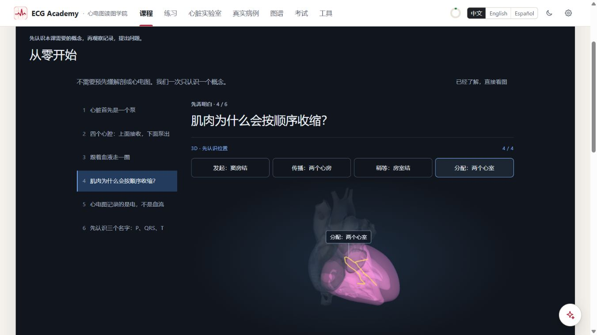

# F1 3D heart introduction — local review, 2026-11-03

User approval: introduce heart anatomy using a 3D model. This follow-up reuses the existing local HRA assets;
it does not introduce another model or change Heart Lab's simulation. F1 now has six introductory pages,
including a new blood-route page; the foundation introductory total is 22 pages.

## Teaching and implementation

- Location: body context, then close-up of the same heart (2 views).
- Chambers: right atrium, right ventricle, left atrium with posterior view, left ventricle (4 views).
- Blood: body → right heart, right heart → lungs, lungs → left heart, left heart → body (4 views).
- Electrical structures: sinus node, atria, AV node/His bundle, ventricular distribution (4 views).
- Each selection has Chinese, English and Spanish explanations. Blood color codes, direction arrows and
  electrical highlighting are described as teaching aids, not quantitative simulation. The route sequence
  does not imply that right and left heart complete separate cycles.
- Rotate by dragging, buttons or arrow keys; zoom by buttons or +/−; Home/reset returns to the teaching view.
  The cutaway checkbox and native slider expose the interior. The existing flat relationship diagram remains
  available for comparison. Changes are manual and immediate, without a continuous animation loop.
- Geometry labels and existing flow/conduction paths are reused; no Lab store or ECG engine is instantiated.
  Original lesson blocks, question identities, chapter mapping and persisted progress structure are unchanged.

## Verification

Full suite: **221 test files passed, 4 skipped; 4683 tests passed, 5 skipped**. After the final visual and
focus adjustments, the foundations/assistant regression passed **12 files / 148 tests**. Typecheck and final
production build passed. The existing single-file build emits its large-bundle warning (about 12.6 MB);
resource splitting remains out of scope. `git diff --check` passed.

The three new tests check real asset chamber labels and laterality, availability of every referenced flow
and conduction structure, the four-topic order, explicit translations and selection bounds. Earlier tests
continue to cover source signals, experiment decisions, timeline, routing/progress and assistant context.

Browser: local preview at `http://127.0.0.1:5173/#/learn/f1/1`.

- Walked all **14 selections** and verified selected descriptions and model availability.
- Checked **36 layouts**: four 3D topics × zh/en/es × 1366×768, 390×844 and 320×844. All canvases loaded;
  none produced page-level horizontal overflow. Titles and canvas sizes are recorded in the JSON below.
- Visually checked body location, posterior left atrium, internal cutaway, blue blood-route arrows and
  gold ventricular conduction paths. Improved torso framing and path contrast during review.
- Mouse drag rotated the model; arrow keys changed orientation without changing the lesson URL. Home reset
  worked. Cutaway slider keyboard operation changed depth from 55 to 56 without navigating the lesson.
- Fixed the introductory page's delayed focus callback, which could steal focus during rapid navigation;
  repeated all 36 layout transitions successfully after the fix.
- No captured browser error entries at final inspection.

Evidence: [14-step walkthrough and 36-layout matrix](foundations-screenshots/f1-3d-walkthrough.json).
This is not a claim that every rotated/cut state was examined in all languages and sizes. Touchscreen hardware,
forced WebGL failure/retry, and OS reduced-motion preference were not separately exercised in this follow-up.
The 3D view has no automatic motion; pointer controls and equivalent native controls were reviewed in source.
The prior full foundation review remains the evidence for the unchanged story, progress and case flows.

## Actual page captures

Delivery is local only. The development preview remains available; no online release was performed.
