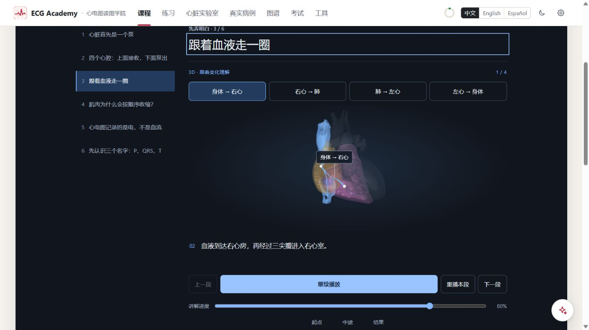
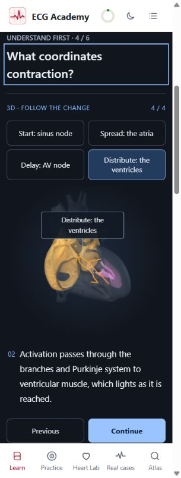

# F1 narrated 3D motion — local review, 2026-11-03

Request: make the existing heart model demonstrate blood flow and electrical propagation in step with the
explanation. This extends the static 3D introduction; it does not replace its anatomy or introduce a new asset.

## Delivered behavior

F1 introductory concept 3 has four blood-route segments; concept 4 has four electrical segments. Each lasts
seven explanation seconds, starts only on request, and holds at its end. Pause/continue, replay, previous/next,
one seek slider, and start/midway/result key frames are available. Switching segments resets playback. Rotating
or operating the model pauses the explanation. The shared clock already handles blur and hidden-tab pause.

The same clock drives the short caption and all visual state. Three overlapping caption copies reserve the
largest translated text height while only the current caption is visible and exposed to assistive technology.
Reduced-motion preference replaces playback with manual key-frame advancement; the slider remains usable.

Blood markers and progressively revealed routes follow the existing `buildFlowNetwork` paths. Venous routes
reach the atrium before the atrioventricular leg; ventricular/outflow routes precede the great-artery leg.
Markers cross each displayed leg once and hold, without a repeating teleport loop. Red/blue denote the
teaching oxygenation code; arrows and moving markers do not represent fluid speed or a whole circulation
completed during one heartbeat. The lungs and body circulation outside the heart are described in captions.

Electrical propagation uses the existing `buildAtrialActivation` and `buildVentricularActivation` solvers on
the same HRA geometry. Mesh vertices read the arrival time of their labelled voxel. Cable timings are sampled
by physical arc length, and Purkinje display paths sample the existing ventricular arrival field. The AV-node
segment keeps ventricular myocardium inactive. Retained colors show reached tissue, not contraction or a
sustained action potential. Anatomical timing is stretched for each teaching segment; no physiological values
are inferred from the seven-second duration. No Lab store, runtime rhythm or ECG engine is instantiated, and
the original lesson waveform engine, routes, progress mappings and answer identities remain unchanged.

## Verification

- Typecheck and final single-file production build passed (about 12.6 MB, existing large-chunk warning).
- Full suite: **221 files passed, 4 skipped; 4687 tests passed, 5 skipped**.
- Final foundations/assistant regression after caption-layout adjustment: **12 files / 152 tests passed**.
- New tests verify upstream/downstream flow ordering, reversible seeking, real-field progressive activation,
  atrial/ventricular isolation, the AV hold, cable arc sampling, and all 24 translated cue texts.
- All **24 key frames** (8 segments × start/midway/result) were visited in the browser. Every model was ready.
- **72 layouts**: 8 segments × zh/en/es × 1366×768, 390×844 and 320×844, sampled at the midway frame.
  No page-level horizontal overflow. Spanish 320 px ventricular captions stayed at **156.25 px** across all
  three frames, confirming no caption-induced movement at that long-text sample.
- Actual playback reached 100% and held for the first blood segment and final electrical segment.
  Blood playback paused at 95% and stayed there on a subsequent observation. Key-frame selection and seeking
  backward restored earlier state. Keyboard Home + ArrowRight set 1% without changing `#/learn/f1/1`.
- Enabled the application's reduced-motion setting, observed manual advancement through 0%, 50%, 100%, and
  restored the original setting. No captured browser error entries during the final model inspections.

Evidence: [walkthrough data](foundations-screenshots/f1-motion-walkthrough.json).
Physical touch hardware, OS preference changes, forced GPU failure and independently forced blur/hidden-tab
events were not exercised in this follow-up. Blur and visibility handling reuse the existing clock unchanged.
The layout matrix does not claim that every camera angle and caption frame was visually reviewed in every
language. Existing foundation compatibility coverage remains in the prior review and regression tests.

## Actual browser captures

The local preview remains available. No online deployment was performed.
