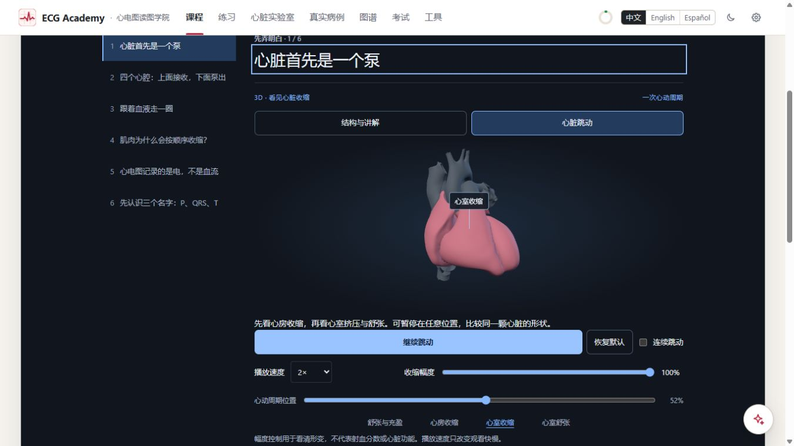
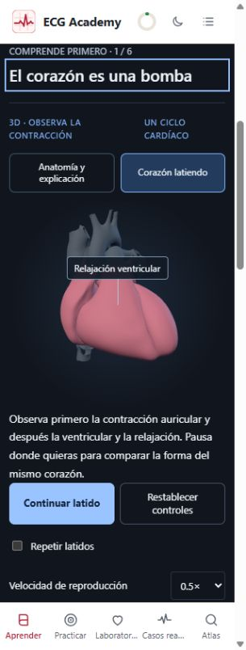

# F1 adjustable heartbeat — local review, 2026-11-03

Request: make the heart itself move and allow adjustment. The first four introductory concepts now offer
“Anatomy & explanation” and “Beating heart” views. The latter shows actual surface deformation of the same
existing model: atrial contraction, ventricular contraction and relaxation, with attached vessels moving too.

## Controls and model

- Start/pause/resume; a single cycle finishes and holds. Optional “Repeat beats” continues only after the
  learner starts playback. Default repetition is off.
- Playback speed: 0.25×, 0.5× (default), 1×, 2×. Changing it during playback preserves cycle position.
- Visual contraction amplitude: 0–100%, default 80%; changing it while paused immediately updates the shape.
  The UI explicitly distinguishes this visual scale from ejection fraction or cardiac function.
- Four mechanical key frames and a cycle-position slider; reset restores the original controls and start.
- Rotation, zoom and anterior cutaway remain available. Switching back restores the anatomical or blood/
  electrical explanation. The original blood/electrical demonstrations also expose playback speed.
- Reduced motion disables automatic repetition/speed selection and provides manual key-frame advancement.

`heartIntroMotion.ts` imports the existing `GLSL_DISPLACEMENT` unchanged. The original chamber-weight volume
is sampled with trilinear interpolation for smooth shared deformation of heart and vessels; deformation is
evaluated in local mm and transformed to the existing world pose. This is radial wall motion and longitudinal
base descent, not scaling the entire mesh. The introductory view uses representative timings for an 800 ms
model cycle; it does not instantiate another ECG engine or claim patient-specific mechanical measurements.
Its texture is disposed with the view. Existing lesson, progress and answer-record contracts are unchanged.

## Verification

- Typecheck and production single-file build passed (about 12.6 MB; existing large-bundle warning).
- Full suite: **222 test files / 4690 tests passed**, 4 files / 5 tests skipped.
- Final targeted tests after the shared chamber-weight integration: **14 files / 173 tests passed**, covering
  foundations, assistant context and existing Lab shaders. `git diff --check` passed.
- New checks cover speed-dependent time advancement, preservation of paused position, opt-in cycle wrapping,
  the shared displacement source, phase order and trilingual key-frame labels.
- Actual browser: four key frames × zh/en/es × 1366×768, 390×844 and 320×844 = **36 layouts**. No horizontal
  overflow or unavailable model. Actual Chinese 100% and 0% amplitude screenshots show shape differences at
  the same cycle position; a Spanish 320 px capture verifies the narrow layout.
- At 0.25×, repeated playback remained active after 22.6 seconds. Changing to 2× kept playback active.
  Pause held the slider at 1% across subsequent observations. Single-beat playback stopped at 100%.
- The application's reduced-motion setting gave manual positions 0%, 14%, 52%, 67%, with repetition disabled.
  The original setting was restored after testing.
- The blood demonstration still sought to 50%; switching to heartbeat exposed the cutaway slider, and
  switching back restored the original “Start demonstration” state. No captured browser errors.

[Control and layout record](foundations-screenshots/f1-pump-walkthrough.json).
Physical touch hardware, forced GPU failure and independent hidden-tab/OS-preference event tests were not
performed. Playback pause on blur/visibility changes uses the existing clock handlers. No online deployment.

