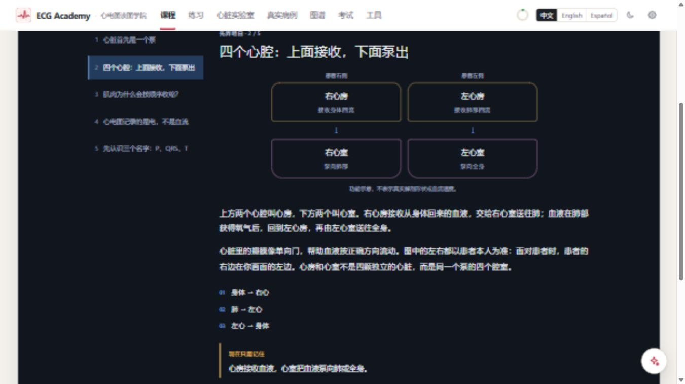
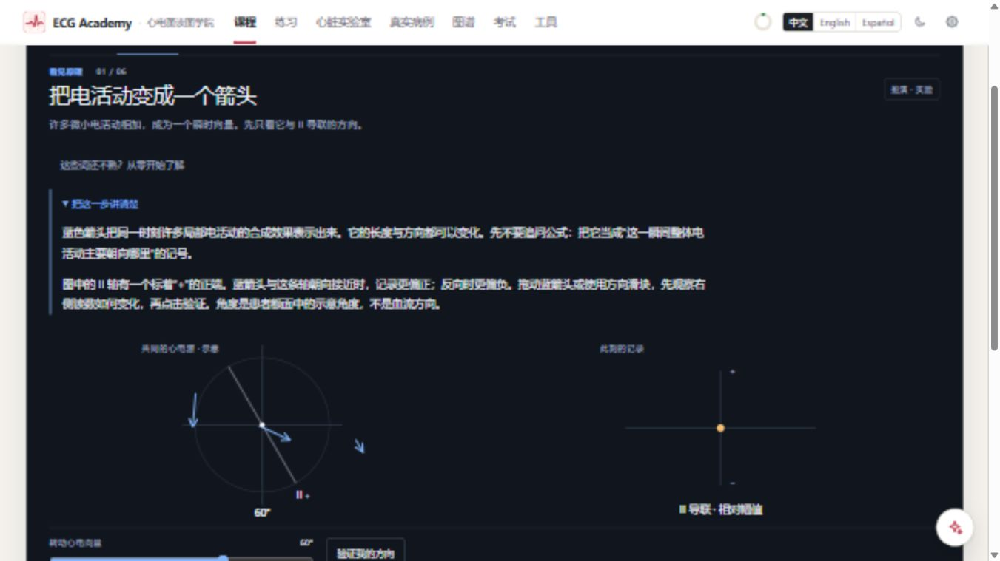
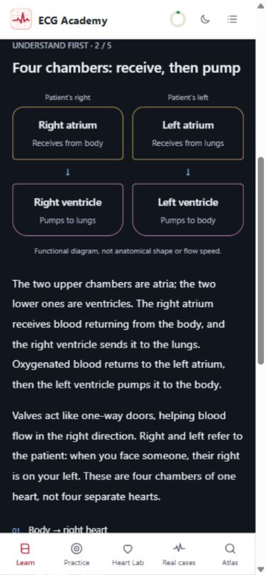
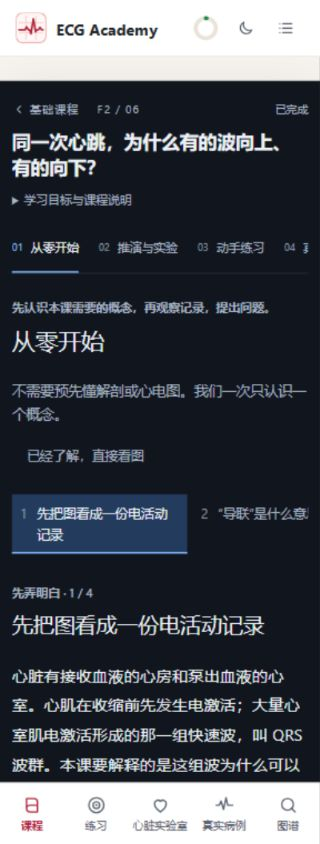
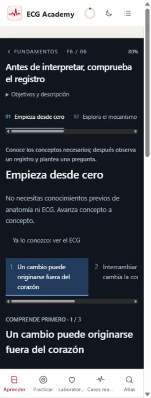

# 基础课零基础讲解补充验收 · 2026-11-03

本轮针对“学生可能完全没有心脏知识”的反馈，在已有 F1–F6 推演播放器上增加前置教学。
本地交付，没有部署线上。上一轮的完整实验与兼容性记录见
[基础课重构验收](foundations-redesign-2026-11-03.md)；本记录仅说明本轮新增内容及实际复查范围。

## 教学内容

- F1：5 页。从心脏作为泵、四个心腔与循环方向，到电激活/机械收缩、电恢复、体表记录、P/QRS/T 和窦房结/房室结。
- F2：4 页。从基线与正负、导联和电极区别，到向量箭头、投影、瞬时读数与整段波形。
- F3：3 页。电位差、RA/LA/LL、患者左右、10 个电极与 12 导联、观察平面。
- F4：3 页。时间/电压坐标、小格/大格、秒与毫秒、纸速、增益、校准脉冲。
- F5：3 页。贴片/线缆/位置、胸骨/肋间/胸骨缘、锁骨与腋线、V4–V6 的水平关系。
- F6：3 页。记录链、伪差、接线与位置错误、共享电极为何影响多条导联。

共 21 页；每页有完整解释、关系顺序与一个要点。全部提供中文、英语、西班牙语。
原有 28 段动画均加入详细解释，说明术语、因果关系及当前图中该观察什么。
F2 的目标、延伸图注和总结也修正了“瞬时垂直等于整段双向”的简化。
短图注仍保持简短，详细说明位于可展开的阅读区。

医学基础内容核对资料：
[NHLBI 心脏解剖](https://www.nhlbi.nih.gov/health/heart/anatomy)、
[NHLBI 心跳机制](https://www.nhlbi.nih.gov/health/heart/heart-beats)、
[Clinical Methods: Electrocardiography](https://www.ncbi.nlm.nih.gov/books/NBK354/)。
原课程专业来源、练习、病例及必要数值保留。

## 实际浏览器走查

1. 六课共 21 个中文概念页逐页打开，确认标题、正文、关系顺序、要点和前后页操作。
2. F2 从第 1 页开始，以键盘 Enter 和鼠标翻完 4 页；最后进入原始问题，原问题的答案按钮和继续学习可用。
3. 从问题进入 F2 动画，第 1 段保持 0%，详细解释默认展开。点击开始，解释收起且时间轴前进。
4. 键盘提交第 1 段实验后，“下一段”解锁。打开入门讲解再关闭，当前实验反馈与解锁状态仍保留。
5. 进入第 2 段，解释重新展开、时间轴回到 0%。播放后展开解释，读到“继续播放”、时间轴停在约 15%，确认阅读暂停行为。
6. 直接打开 F2 旧路径 `#/learn/f2/2`，仍可显示动画并随时补看入门概念。
7. 六课入口分别检查 zh/en/es × 1366×768、390×844、320×844，共 54 种组合；每个入口均有正文，页面宽度未超过视口。
8. F1 四腔功能图检查中文桌面和英语 390px：患者左右、心房/心室、流向标签清楚，移动端左右两列仍可阅读。
9. 中文 F2 320px 和西语 F6 320px 截图检查；概念导航允许局部横向滚动，正文自然换行。
10. 本轮页面日志未发现 error。结束时恢复中文并清除临时视口尺寸。

布局测量与概念标题记录：
[beginner-layout-matrix.json](foundations-screenshots/beginner-layout-matrix.json)。
入口矩阵是 DOM 宽度与内容检查，并非对每个内容页、每个语言都逐像素审查。
本轮没有重新完整走查全部 28 个实验，也未使用实体触摸屏；未声称上述两项新增验证。

## 自动验证

- `npm run typecheck`：通过。
- `npm test -- --maxWorkers=4 --reporter=dot`：220 个文件通过、4 个跳过；4680 项通过、5 项跳过。
- 最终文案调整后重跑 `npm test -- tests/course tests/assistant/context.test.ts --maxWorkers=4 --reporter=dot`：29 个文件、1060 项通过。
- `npm run build`：最终版本通过，生成自包含 `dist/index.html`。现有单文件体积提示仍存在，本轮未改变资源拆分策略。
- `git diff --check`：通过。

新测试校验六课前置内容的显式三语覆盖，以及每个动画段 ID 都有详细解释且没有悬空条目。
现有课程、数值、原链接/章节映射和 AI 上下文回归继续通过。
首次默认并发的全套测试未及时输出进展，已中止并以 4 个并发重跑完成。
最终课程回归曾发现 F2 延伸图注超过旧有 2 句限制，已缩短图注并保留详细阅读区，再次通过。

## 实际页面截图

本轮使用实际视口截图。全页截图接口未成功，因此不把这些文件标为完整页面。

